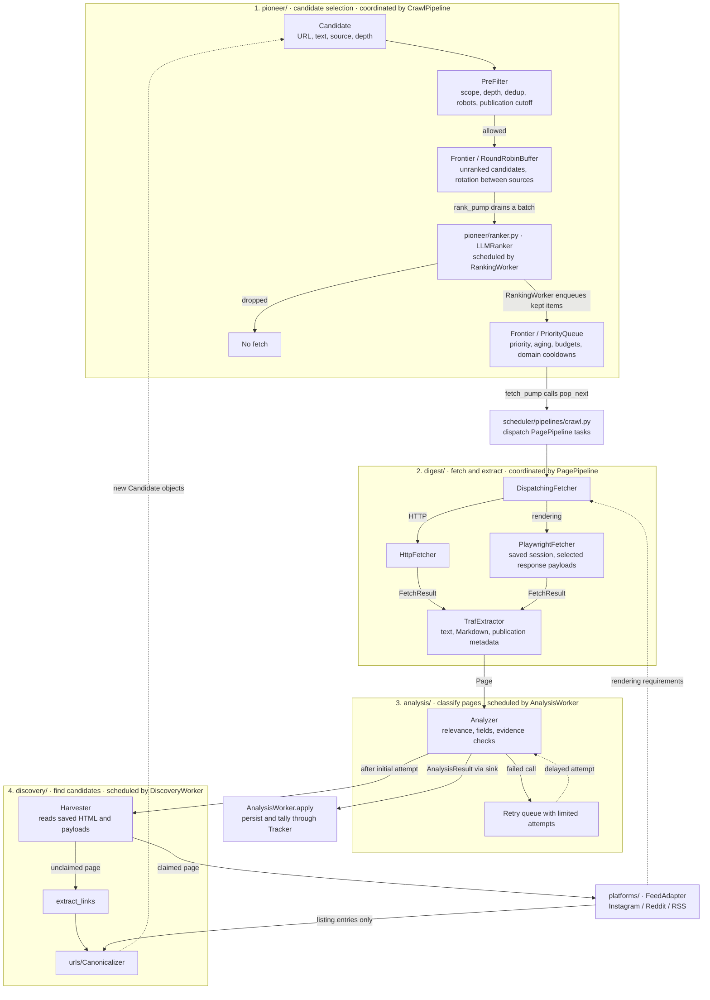
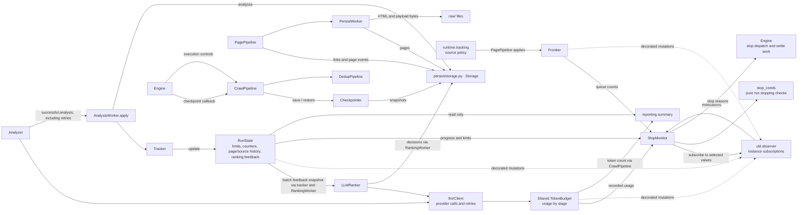
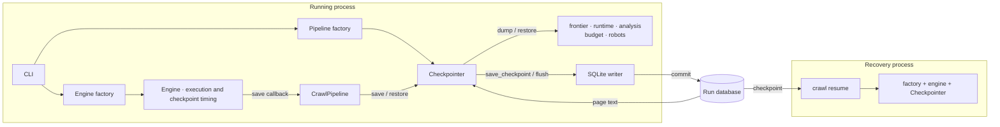

# Architecture

`crawlme` separates discovery, page processing, analysis and scheduling.
Data models live in their owning packages and are exported through `__init__.py`.
Goals and task records live in `runtime/`; run-wide data lives in `runtime/state.py`.
`prompts.py` holds LLM instructions and input formatting.
Stage modules own model calls, retries and response validation.

## Data ownership

| Location | Types |
|---|---|
| `urls/models.py` | URL identity and raw links |
| `runtime/goal.py`, `runtime/task.py` | Goals, extraction specifications and task records |
| `pioneer/models.py` | Candidates and frontier entries |
| `digest/models.py` | Fetch results, pages and retained payloads |
| `analysis/models.py` | Analyses, result items, extracted fields and feedback |
| `discovery/models.py` | Harvest results |
| `platforms/models.py` | Feed entries, listings and content problems |
| `dedup/models.py` | Validated groups and grouping responses |

Component-specific types stay beside their component. Ranking decisions and history
live in `pioneer/ranker.py`; frontier snapshots live in `pioneer/frontier.py`.
Run state stays in `runtime/state.py`. ID helpers live in `util/ids.py` and date
helpers in `util/dates.py`.

Packages export their public types through `__init__.py`. Where loading an
implementation would create an import cycle, the package loads that export when it
is first accessed. Importing a page or analysis model does not load its workers.

## Components



The numbered stages follow one candidate URL. `rank_pump` and `fetch_pump` run
concurrently across different candidates, sharing the frontier's two queues.
`FetchWorker` returns the fetched response. PagePipeline calls `PersistWorker.save_raw`
before invoking Extractor, then `PersistWorker.save_extracted` before analysis.
Harvesting follows the initial analysis attempt and can proceed while a failed
analysis waits for a retry. Analyzer output goes to its sink. Discovery reads the
saved page inputs. Dashed arrows show delayed work or candidates for a later pass.

| Location | Responsibility |
|---|---|
| `cli/` | Parse commands, apply settings, build goals, report results |
| `cli/__init__.py` | Dispatch commands, close LLM clients, emit reports and apply exit codes |
| `cli/report.py` | Format crawl, replay and dedup reports and derive exit codes |
| `scheduler/engine/factory.py` | Create a generic Engine and bind a supplied Pipeline |
| `scheduler/pipelines/factory.py` | Assemble and inject workers and their component dependencies |
| `scheduler/engine/engine.py` | Run lifecycle, stopping and admission policy, checkpoint timing |
| `scheduler/pipelines/crawl.py` | Module calls, pumps, page tasks, retry execution and dedup |
| `scheduler/pipelines/page.py` | Process pages, resume stages, admit candidates and paginate |
| `scheduler/workers/ranking.py` | Rank batches, save decisions and enqueue retained items |
| `scheduler/pipelines/pipeline.py` | Shared execution protocol and callbacks from engine |
| `scheduler/pipelines/dedup.py` | Execute final grouping and retain originals on failure |
| `scheduler/pipelines/replay.py` | Analyze stored pages, drain retries and return replay counts |
| `scheduler/workers/` | Execute stages, persist their results and update stage statistics |
| `scheduler/reporting.py` | Read RunState to build the CLI report |
| `scheduler/stop_conds.py` | Evaluate run stopping conditions |
| `urls/` | URL identity, raw links and canonicalization |
| `pioneer/` | Filter, buffer and rank candidate URLs, and enhance goals and expand seeds |
| `digest/` | Fetch pages and extract text and metadata |
| `discovery/` | Discover candidates and pagination through adapters or ordinary links |
| `platforms/` | Platform recognition, parsing, rendering and session requirements |
| `analysis/` | Classify pages and extract fields with source evidence |
| `dedup/` | Group equivalent relevant analyses and describe their shared topic without fusing source fields |
| `llm/` | Provider calls, retries, JSON parsing and shared token accounting |
| `runtime/tracking.py` | Update RunState, join page verdicts, provide ranking feedback and define source retirement rules |
| `runtime/goal.py`, `runtime/task.py` | Crawl goals, extraction specifications and task lifecycle records |
| `runtime/state.py` | Own run limits, counters, page/source history and seed expansion metadata |
| `runtime/events.py` | Persist crawl events |
| `persist/storage.py` | Storage implementation using SQLite and raw files |
| `persist/read.py` | Open existing databases read-only and load stored results |
| `persist/queries.py` | Share result queries and dedup input mapping across readers |
| `scheduler/workers/persist.py` | Coordinate page file writes and database queuing through Storage |
| `util/dates.py` | Parse event dates and assign result groups |
| `dashboard/` | Local HTTP server and browser UI for stored results |

Workers are concrete classes with different input and output types, not interchangeable
pipeline steps. They do not receive the engine. Analysis and ranking workers update
state through Tracker. CrawlPipeline owns module calls and task handles. PagePipeline
owns page ordering, candidate admission and cross-stage tracking; RankingWorker applies batches.
CrawlPipeline, PagePipeline, DedupPipeline and ReplayPipeline explicitly implement `Pipeline[Input, Output]`,
with `run(input, context)` and `aclose()`.
PipelineContext carries supervision,
settlement, admission and checkpoint callbacks. Task metadata and events travel in
the pipeline input. Workers use the existing
Fetcher, Extractor and Ranker protocols, and the concrete Analyzer and Harvester stages.

The pipeline factory assembles crawl, replay and dedup pipelines and their workers.
All three builders return a Pipeline. The generic Engine factory creates an Engine,
binds the supplied pipeline, and returns it for `engine.run(input)`. It has no
business-specific branches. CLI commands create their pipeline, pass it to
`create_engine`, then call `run`. The pipeline factory creates shared crawl state,
frontier and budget; the monitor factory uses those same instances through public
properties. Commands do not construct buffers or concrete monitors. Source selection and seed-file parsing stay in `pioneer.sources`.
CrawlPipeline retains Checkpointer binding and restoration; Engine receives its save
callback and controls checkpoint timing and shutdown.
CLI commands pass settings and feature switches rather than constructing LLM components. CrawlPipeline runs seed expansion;
PagePipeline provides verification using the same FetchWorker, PersistWorker
and DiscoveryWorker as crawling. It obeys robots rules and cooldowns, saves HTML
and payloads, and discovers candidates without publishing an unextracted Page row.
`create_crawl(..., fetcher=stub)` overrides a component.
`create_crawl(..., ranker=stub)` supplies the ranker used by RankingWorker.

## Crawl lifecycle

1. The CLI applies flags, validates dependencies and session settings, and creates
   a goal, task, crawl pipeline and shared `TokenBudget`.
2. `GoalEnhancer` derives the goal statement, fields and optional publication
   cutoff. An explicit `--since` overrides the inferred cutoff.
3. Optional seed expansion proposes URLs and verifies that fetched pages yield
   candidates. Accepted proposals receive a smaller share of candidate rotation.
4. Seeds are canonicalized, filtered and queued at priority `1.0`, depth `0`.
5. CrawlPipeline runs `fetch_pump` and `rank_pump` concurrently. Engine enforces admission
   and stopping decisions supplied by StopMonitor. The monitor reads queues, limits,
   progress and token usage from their owners.
6. On normal completion, the scheduler settles page tasks and analysis retries, then
   optionally groups results and closes resources. Ctrl+C cancels active work without
   draining or grouping. Stage boundaries and a periodic timer save recovery checkpoints.

Without LLM configuration, enhancement and analysis are absent and candidates are
queued without LLM ranking. Deterministic URL filtering still runs.

### Fetching and discovery

For a discovered candidate, ranking precedes dispatch, fetching and analysis.
Seeds and listing continuation URLs bypass ranking after filtering. Each dispatched
item is fetched, saved as raw HTML, extracted to a `Page`, and persisted before
analysis. The harvester then reads the saved HTML and payloads to discover new
candidate URLs, which return to the unranked buffer through the pre-filter.

- `DispatchingFetcher` chooses Playwright for enabled adapters that require
  rendering and HTTP otherwise. `--fetcher browser` forces Playwright everywhere.
- Playwright starts lazily, shares a browser context and opens a page per fetch.
  Adapters select response payloads to retain and whether to scroll.
- `TrafExtractor` uses trafilatura for text and Markdown, with BeautifulSoup as a
  fallback. Publication dates come from declared metadata, JSON-LD or time tags.
- `Harvester` asks adapters in order. A recognized post is a leaf. A listing
  supplies post candidates and optional pagination. An unclaimed page supplies links.
- Pagination keeps the listing's depth and has a per-listing cap. Discovered posts
  and ordinary links increment depth.
- Pre-filtering applies URL, scope, depth, duplication, robots and publication rules
  before candidates enter the unranked buffer. Seeds bypass some traversal filters.

| Adapter | Recognition and content |
|---|---|
| Instagram | Host-based, requiring a session and rendering. Listing payloads provide captions and timestamps, with DOM fallback |
| Reddit | Host and rendered markup. Listing cards provide post candidates and pagination |
| RSS/Atom | Document root. Entries provide content, links and publication dates. Requires `feedparser` |

Adapters parse saved inputs and perform no network requests. Adding a platform
requires implementing `FeedAdapter` and registering it in `platforms/__init__.py`.

The extractor also asks the first URL-matching adapter for page text through
`extract_text(FetchResult)`. Instagram matches the requested post in captured payloads
or inline JSON and merges its caption with distinct carousel captions. Other adapters
return `None`, keeping generic HTML extraction. Missing target text also falls back
to HTML. This reads fetched detail-page data, not `Candidate.text` from ranking.
The selected text is saved in `Page.plain_text` and `markdown`. Adapter text records
its platform in `metadata.text_source`. Analysis still applies its character limit.

### Ranking and analysis

`RoundRobinBuffer` rotates candidate batches between seeds. `LLMRanker` uses the
enhanced goal, requested fields, candidate text and previous analysis results.
It splits calls by candidate count and text size. Truncated batches are subdivided.
Omitted candidates receive neutral priority. Unrecoverable errors propagate to
CrawlPipeline through supervised work. Engine freezes checkpoint writes before
canceling active work; CrawlPipeline cancels remaining tasks and records failure.
Unexpected page-task exceptions also stop the run and produce a FAILED task.
Checkpoint recovery creates a new run owner from saved state; see the
[Engine execution](engine.md). `--recall` retains rejected candidates at low priority.

`Analyzer` requests a page relevance verdict and an `items` array. Each item is
an independently useful answer to the goal, with a summary, score, source quotes,
tags, declared fields and optional dates. The page itself may be the single item.
Object attributes and conditions stay together; distinct answers are separate.
Each field contains a value and a verbatim evidence span.
The parser normalizes whitespace and checks evidence against `plain_text`. This
does not independently verify the value. Fields without matching evidence are omitted.
Failed analyses enter a retry queue with a limit on attempts per page. Successful
results reach the scheduler through a sink, including successes from delayed retries.

`analysis_items` stores application-assigned IDs linked to their parent analysis.
Parent and item writes are atomic. A null `analyses.item_count` denotes a legacy
single-result record; zero denotes a new analysis with no items. Readers select the
latest page analysis before expanding its items, so an empty replay supersedes old
results. Legacy analyses remain single rows until replayed. Relevant-page limits
and source-retirement votes remain page-based; reports count items separately.

`AnalysisWorker` limits initial calls and checks the result target after acquiring
its slot. AnalysisWorker owns the retry queue; PagePipeline owns its preparation, retry
startup, draining and shutdown. CrawlPipeline coordinates PagePipeline lifecycle.

Analysis feeds relevant-page summaries back to ranking. It does not nominate links
or bypass the harvester. Platform posts are leaves in the current traversal.

### Event dates

Publication time controls `--since` and source retirement. Known old candidates are
filtered before ranking. If the date becomes available only after fetching, the same
cutoff skips analysis while preserving the page and link discovery. Unknown dates
remain eligible. Event dates describe what a page announces and affect result grouping only.

Goal Enhancer independently sets `time_policy` to describe the relevant validity
window, or null for timeless/uncertain goals. This does not require a user-requested
date field. Analyzer returns separate `time` endpoints for each item with source evidence in the
same call, with publication date supplied as extraction context. Analyzer does not
classify temporal status; inspect and the dashboard compare the extracted dates
with the current UTC date.
Evidence must match source text after whitespace and Unicode compatibility
normalization. Expanded endpoints may be supported by a compressed source range;
unsupported, ambiguous or inverted dates remain unknown. Legacy goals
can still use `extraction_spec.time_field`. The parser
reads ISO dates and English month names. Explicit years take precedence. Omitted
years are resolved near publication, or against the current year when publication
is unknown. Relative phrases are not resolved.

`group_of()` assigns `undated`, `over`, `open` or `later`. An end date before today
is `over`. A start after today is always `later`. The UI labels are Past, Upcoming,
Ongoing and Validity unknown. A past start without an end does not establish
ongoing validity. Topic relevance remains separate from expiry. All temporal states are visible
initially; the dashboard filters them only when the reader selects a filter.
Inspect and the dashboard first select the latest analysis for each goal and URL
(by analysis time, then insertion order for ties). Older replay revisions remain
in storage but cannot override the current dates or verdict.
Dashboard and inspect apply `during` as a future-start cutoff,
not a change of status. Dashboard hides time controls for non-temporal goals.

Public types are exported from package entry points, including `runtime.RunState`,
`runtime.Tracker`, `persist.Lock`, `persist.Results`, `scheduler.Engine`, and
`llm.Client`, `llm.LLMResponse` and `llm.TokenBudget`. Analyzer, Harvester and Frontier are
concrete classes exported by `analysis`, `discovery` and `pioneer`; each has one
implementation. Class implementations inherit their protocols explicitly; platform
adapters implement `FeedAdapter` as modules.

## State and concurrency

The scheduler connects stage outputs to shared services. These are coordination
and data dependencies, rather than additional steps in the candidate path above.



CrawlPipeline exposes `run_state`. `RunState` owns run-wide data:

- `Limits` holds immutable run budgets and goal constraints.
- `Progress` holds runtime-owned counters used by stopping policies. TokenBudget owns token usage.
- `Stats` holds reporting statistics.
- `seeds` holds per-source counters, retirement history and pagination counts.
- `pages`, `page_contexts` and `relevant_pages` hold page associations and ranking feedback.
- Seed expansion metadata records proposed and rejected sources.

Startup reset clears execution history and counters while preserving prepared seed
URLs, proposal metadata and recorded pre-run token usage. It retains the RunState
object's identity. Resume restores checkpoint data after this initialization.

`Tracker` holds only a reference to RunState and updates it synchronously on the
event loop. AnalysisWorker applies initial and retried results, then notifies PagePipeline
to check source keys with `why_retire` and retire queued work through Frontier.
Reporting reads RunState directly. RankingWorker receives
a snapshot of recent relevant pages and the current batch's source contexts, so
later analysis updates affect later batches.

Frontier owns queue internals, CrawlPipeline owns pump and page task handles, and TokenBudget owns token
accounting. These resources are not duplicated in RunState. The single-page path
passes `FrontierItem`, `FetchedPage`, `Page` and `Harvest` between stages. Delayed
analysis results join run-wide records by page identity.

`PageBook` joins each page's seed, listing status and analysis verdict. These may
arrive in different orders because analysis can retry. A completed non-listing
record contributes one relevance vote to its seed. PagePipeline retains page records and
contexts while page tasks, analysis retries or waiting/active ranking batches need
them, then releases them. PagePipeline observes Frontier context-key changes to
release completed ranking inputs without a cleanup call from CrawlPipeline. Dispatched
work entries protect pages that have not started yet. Bounded relevant-page summaries
remain separate.

The frontier owns both the scored queue and unranked buffer. CrawlPipeline waits for ranking
through `wait_for_ranking` and signals changes through `wake_ranker`. Queue counts
are public, and the buffer stays private. Scored work is gated
by domain budgets and cooldowns. Ranking in progress and cooling items count as
remaining work, so an empty immediate pop does not imply a drained frontier.

Buffer seen keys record admission history, including drained and evicted candidates.
Frontier visited keys record settled outcomes; duplicate outcome delivery does not
charge budgets twice. Queue membership includes waiting, cooling and in-flight URLs.
These histories prevent repeat admission and grow with distinct URLs. Retirement
blocks late ranking results as well as new candidates. Snapshots retain retired
sources and unfinished ranking batches; restored batches return to waiting.

PagePipeline bounds the combined fetch, extraction and persistence work with page slots.
FetchWorker also bounds network fetching. Analysis has separate slots and does not
hold a page slot. Dispatch counts in-flight pages against the page budget. The result
target and other run limits are checked through an engine callback after acquiring
an analysis slot; already-running calls may overshoot the target.
Blocking extraction runs in worker threads. Digest operations using libxml2 share
`LXML_LOCK`. Extraction timeouts bound the await, not the lifetime of a running thread.

## Stopping and checkpoints

`RunState.progress` holds only run-owned counters. The monitor factory creates StopMonitor
with RunState, Frontier and TokenBudget. Monitor reads queue counts and token usage
directly from their owners and passes numbers alongside Progress and Limits to
`check_stop()`. RunState does not bind owners or proxy their counts.

Mutation methods carry only `@notify`. RunState, Frontier and TokenBudget do
not bind listeners, store callbacks or select watched values. StopMonitor subscribes
to those values through `util.subscribe()`. The notification tool compares them
before and after a method, including partial mutations before an exception or
cancellation, and invokes the callback synchronously.

Monitor owns its revision and Event. It waits for notifications and deadlines,
then reevaluates stopping policies. Ordinary progress does not wake Engine. Engine
waits for a stop result or pipeline completion. Revisions preserve updates between
checking conditions and starting the wait. Subscriptions are isolated by object
identity, hold weak references to owners and bound callback receivers, and are
removed when Engine closes Monitor.

Monitor also supervises settlement. Pages may finish after fetch exhaustion or meeting
the result target. Token/time exhaustion, platform refusal and fatal errors cancel
remaining page work. Analysis retries may run after fetch exhaustion, but stop on the
result target or a hard limit. Page and retry settlement share a deadline.
Admission checks guard newly dispatched work and newly acquired analysis slots.
Fetch dispatch retains its scheduling poll. Checkpoint intervals, domain cooldowns and
ranking batch timers remain separate scheduling concerns.

Task lifecycle has one owner, CrawlPipeline, and one value, `CrawlTask.state`.
`task.stopping_reason` records the stop decision for reporting; policy does not read it.
Ctrl+C cancels the run directly and records `INTERRUPTED` with `USER_REQUESTED`.
There is no separate programmatic stop interface.

| Reason | Trigger |
|---|---|
| `BUDGET_PAGES`, `BUDGET_TOKENS`, `BUDGET_TIME` | A run budget is exhausted |
| `MAX_RELEVANT` | The relevant-result target is met |
| `FRONTIER_DRAINED` | No queued, buffered, scoring or in-flight work remains |
| `DOMAIN_BUDGET` | A drained run refused candidates at a domain ceiling |
| `RATE_LIMITED`, `LOGIN_REQUIRED` | An adapter reports a run-level refusal |
| `ADAPTER_EMPTY` | A drained run read at least three listings and all yielded no candidates |
| `FATAL` | A component reports an unrecoverable error |

The policy in `runtime.tracking` retires sources after fewer than two relevant results in a full
20-page window, or five consecutive dated pages older than `since`. Listings do
not vote on relevance. Undated pages neither advance nor reset the age streak.
Retirement removes that seed's pending candidates. `--recall` disables retirement.

`crawl resume <task-id>` starts a new scheduler in the original run directory.
Checkpoints contain the goal, non-secret settings, frontier, source history, counters,
token usage, incomplete page stages and analysis retries. Page text stays in the
existing page rows. Resume does not enhance the goal or expand seeds again. It restores
elapsed execution time, excluding time spent stopped. Credentials come from the
current environment; an OS file lock excludes another crawl owner for the same run.

The scheduler saves an initial checkpoint before dispatch, after page stages and
ranking batches, and every two seconds. Results enter the writer queue before their
checkpoint. Recovery reads only committed snapshots; a failed write prevents a new
checkpoint from being committed. Work newer than the snapshot can repeat. Stable
analysis and result-item IDs replace repeated outputs for the same task and URL.
This does not guarantee exactly-once requests or billing. Usage not present in the
checkpoint cannot be reconstructed from an interrupted provider request.

Ctrl+C cancels page, ranking and retry tasks immediately, then closes local resources.
It does not wait for model responses or run dedup. The task becomes `INTERRUPTED`;
a hard-killed task can still say `RUNNING`, but the OS releases its lock. A second
Ctrl+C exits immediately. Recovery does not depend on a final checkpoint during exit.
The old in-memory pause/resume API has been removed. Frontier-only legacy snapshots
are not sufficient for recovery and are rejected by the resume command.

The factory assembles `Checkpointer` with explicit dependencies. Each participant
inherits `Checkpointable` and implements `dump()` and `restore()`. The analyzer's
goal is bound before startup and recovery. `RunState` saves in-flight page stages
and PageBook, while Frontier saves its queue and buffer.

Engine owns checkpoint timing and execution controls. CrawlPipeline owns recovery and crawl task records. Checkpointer
captures component state before awaiting, removes page text from snapshots, restores
it from stored page rows and serializes writes. CrawlPipeline emits the saved event only
after persistence succeeds.



## Persistence and inspection

At run completion, the scheduler settles pending Analyzer retries independently
of dedup. Page limits and frontier exhaustion allow already-fetched pages to finish
analysis. Token/time limits, the result target, user stop and run failures cancel
remaining retries. Page and analysis settlement share one 120-second
shutdown deadline. Analysis closes before
optional grouping, so grouping sees a stable set of results.
When dedup is enabled, the scheduler passes relevant items and source evidence to `dedup/grouper.py`.
One LLM call proposes duplicate groups. Unassigned analyses become singletons.
Duplicate or unknown member IDs invalidate the response and are reported separately.
Malformed JSON, schema errors and invalid members trigger at most one correction
request, with the original inputs, failed response and validation feedback. Each
request obeys the token budget and input-size limit. Failed responses are recorded
in the run log without printing their full content to the terminal. Truncated
output is rejected without a correction request. A second invalid response leaves
existing results unchanged. Inputs
over the configured character limit are not submitted. Failure preserves original
results. Grouping decisions do not affect source retirement or crawl stop conditions.

Storage atomically publishes `dedup_runs` (input fingerprint and model),
`result_groups` (overview), and `result_item_members` (item IDs). Legacy snapshots
retain `result_members` (analysis IDs). Original
analyses remain intact. The dashboard reads the latest matching snapshot. A replay
that changes the inputs invalidates it. Replay regroups the selected goal after analysis unless `--dedup off` is set.
`crawl dedup <task-id> --goal <goal-id>` regenerates groups from stored analyses.
Semantic grouping remains open (reviewed 2026-10-06). Model responses can still
merge distinct items, different editions or partially overlapping records despite
the shared-identity rules. The correction attempt validates JSON and member IDs;
it does not validate semantic equivalence. Evaluate explicit identity evidence and
per-member support before treating a successful grouping as semantically verified.

Both automatic and standalone dedup use DedupPipeline for reading inputs, grouping
and publishing results. The shared factory builds Grouper and injects storage,
the token budget and the error handler.
Storage and the dashboard share the input query and row mapping in `persist/queries.py`,
so snapshot validation uses the same evidence as grouping. Analyses join their exact
page version by `page_id`.
Each multi-source card shows an overview, arithmetic mean relevance, and source
cards with their original fields and dates. Search and field filters can match any
member without hiding other members. Date filters use open if any member is open,
otherwise undated if any is undated, otherwise later if any starts later, and over
only when all members are over. Conflicting dates are not collapsed for end-date
sorting. The overview must acknowledge material disagreements rather than resolve
them. Grouping is model judgment, not a guarantee of semantic equivalence.

The CLI flag `--dedup on/off` defaults to `on`. Reasoning effort is independently
configured with `LLM_DEDUP_REASONING_EFFORT=off`. Model, credentials and token budget
are shared with the other stages. Grouping consumes the remaining budget, so a run
that has exhausted it retains original results. Final reports bypass verbosity
filters for the run file and include dedup's token usage.

Each run has its own directory:

```text
results/<timestamp>/
  db/crawl.db
  raw/<url_key>/<fetch_id>.html
  raw/<url_key>/<fetch_id>.payload.<index>
  log
```

SQLite stores goals, tasks, pages, links, rank decisions, analyses, frontier
snapshots, events, errors and robots cache entries. Most writes use an async queue.
Grouping snapshots use an explicit transaction. Reads use the connection directly.
Events provide an audit trail. Checkpoints restore the frontier.

PagePipeline invokes PersistWorker before and after extraction. The worker calls Storage
to retain HTML before extraction, then saves payloads, attaches their paths to the
Page and queues the Page record. File writes run in threads. Database writes are
queued on the event loop. A failed payload write is logged and omitted from the
saved paths. Storage owns paths and the underlying file and database operations.

`crawl inspect` displays stored results and exports JSON or CSV. It loads results
through `persist/read.py` in a worker thread using a read-only transaction, without
schema setup, a write queue or a run log handler. Run lookup also opens databases
read-only. The dashboard uses the same read-only connection helper and filters
results in the browser.

`crawl replay` uses Engine and ReplayPipeline to analyze stored page text without
refetching or re-extracting HTML. ReplayPipeline reuses AnalysisWorker for concurrency,
error policy, retries and publishing, then calls DedupPipeline with the same token budget.
CLI commands use one report formatter, which renders the available statistics, and
return report text and an exit code. The shared dispatcher closes
LLM clients, prints and persists reports, and applies exit codes. Resume passes
recovery input to the same CrawlPipeline. Run lookup and stored-model decoding live in
`persist.read`, shared by the commands.
It skips matching `(url_key, goal_id, spec_version, model)` analyses
unless forced. A new goal prompt creates or reuses its content-derived goal ID.
After editing analyzer instructions, use `--force` to reanalyze existing results.
Storage includes a targeted migration for `time_policy`, but no general migration
scheme that guarantees compatibility across versions.
