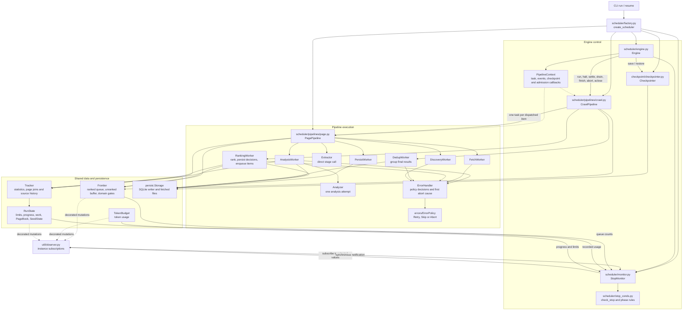
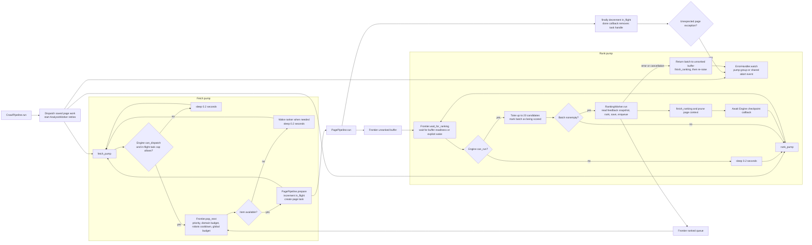
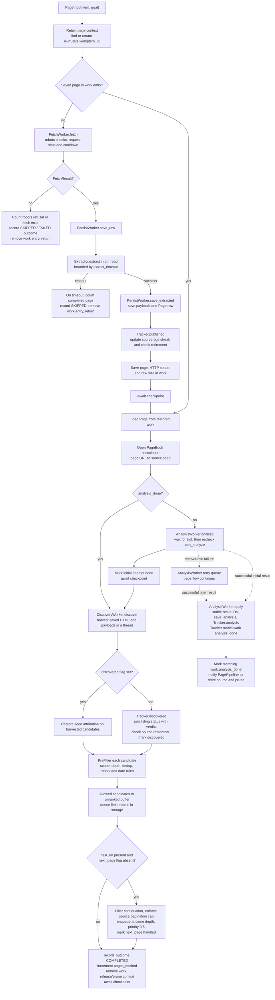
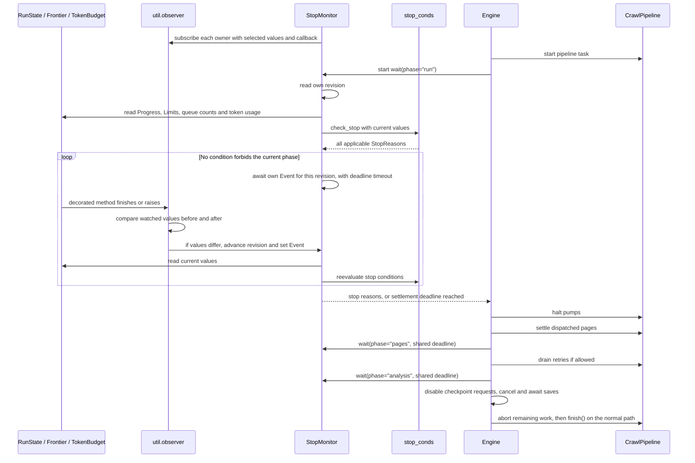
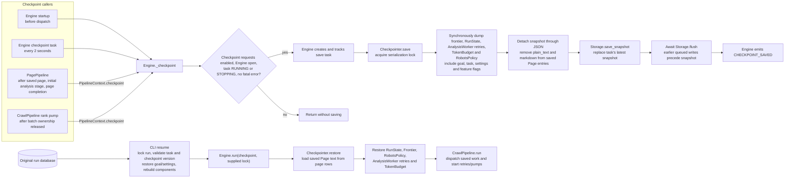
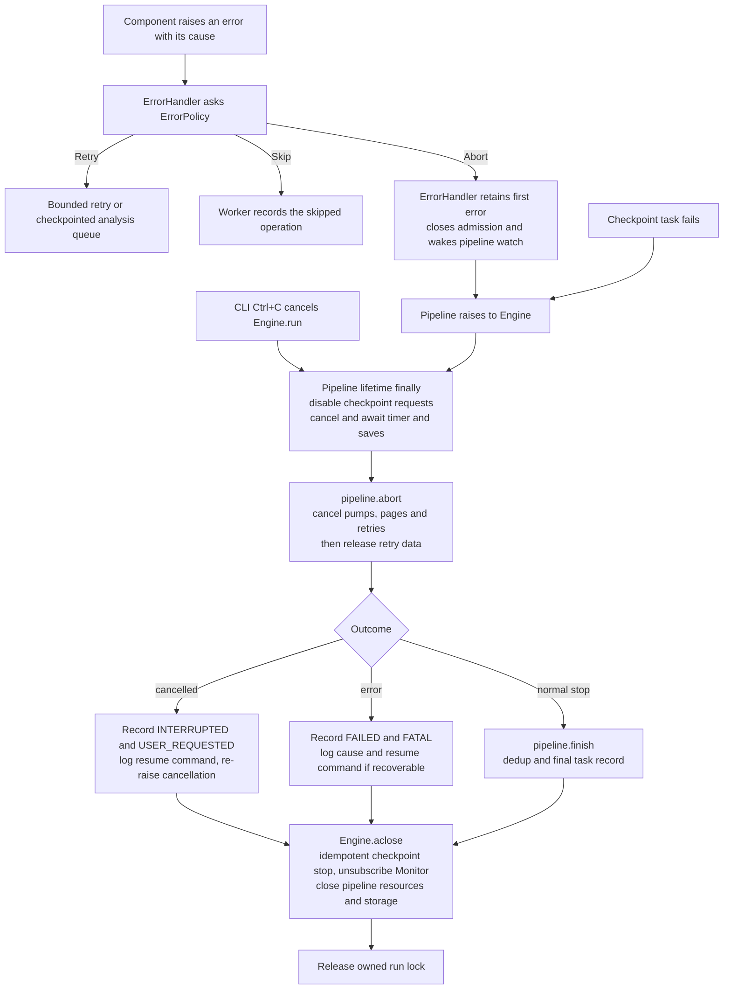

# Engine execution

This document describes the current implementation, checked on 2026-10-13.
Engine controls a crawl's lifecycle, admission rules, stopping and checkpoint timing.
CrawlPipeline owns the concurrent crawl tasks. PagePipeline coordinates the stages
for one page. The factory wires these objects together.

## Ownership and calls



Engine receives a concrete CrawlPipeline and a StopMonitor assembled by the factory.
Monitor reads RunState, Frontier and TokenBudget directly. `Pipeline` defines only `run(input,
context)` and `aclose()`; CrawlPipeline also exposes the lifecycle methods that
Engine calls. Workers perform their stage's work. Pipelines order stages and own
task handles. An Extractor is called directly by PagePipeline, without a separate
extraction worker.

`CrawlTask.state` is the task lifecycle state. `RunState` contains execution data.
It has no second copy of the task lifecycle. `SeedState` records one starting
source's counts, relevance window, age streak, pagination and retirement reason.

## Startup and Engine.run

For a fresh run, the CLI creates the shared token budget and components, reads
the supplied seeds and calls `CrawlPipeline.startup()`. The pipeline ingests those
seeds, enhances the goal and optionally expands seeds. Startup model calls share
the ErrorHandler injected by the factory. Workers require this shared instance. A startup abort
is retained until Engine saves the initial seeds and starts the pipeline. Seed verification uses `PagePipeline.probe()` to fetch
and save raw inputs, then harvest them without analysis. These steps precede
Engine.run. Accepted seeds enter the ranked frontier directly at priority 1.0.

```mermaid
flowchart TD
    Entry["Engine.run(goal, task, checkpoint?, lock?)"] --> Guard["Reject an already started or closed Engine"]
    Guard --> Lock["Acquire run lock unless the caller supplies it"]
    Lock --> Running["Set CrawlTask.state = RUNNING<br/>start storage and create EventEmitter"]
    Running --> Reset["RunState.reset(goal)<br/>preserve prepared seed URLs and expansion metadata"]
    Reset --> Prepare["pipeline.prepare(goal, task_id, events)<br/>start page tracking and prepare AnalysisWorker"]
    Prepare --> Bind["Checkpointer.bind(goal, task, pipeline.features)"]
    Bind --> Restore{"Checkpoint supplied?"}
    Restore -->|yes| Load["Checkpointer.restore<br/>load saved component and page-stage state"]
    Restore -->|no| SaveRows
    Load --> SaveRows["Queue goal and RUNNING task records"]
    SaveRows --> Initial["Await initial checkpoint save and flush"]
    Initial --> Timer["Start checkpoint task<br/>save every 2 seconds"]
    Timer --> Context["Create PipelineContext<br/>callbacks belong to Engine"]
    Context --> Launch["Start pipeline.run as an asyncio task<br/>yield once so restored work can register"]
    Launch --> Failure{"Startup aborted?"}
    Failure -->|yes| StartupFail["Pipeline raises the retained error<br/>keep initial checkpoint"]
    Failure -->|no| Supervise["_supervise<br/>wait for pipeline, StopMonitor or checkpoint task failure"]
    Supervise --> Stop["Record returned stop reasons<br/>set task.state = STOPPING"]
    Stop --> Deadline["Create shared settlement deadline<br/>now + 120 seconds"]
    Deadline --> Halt["pipeline.halt<br/>cancel fetch and rank pumps"]
    Halt --> Settle["_settle<br/>wait for dispatched pages under page-phase rules"]
    Settle --> Drain["_drain<br/>wait for retries if analysis-phase rules allow"]
    Drain --> Freeze["finally<br/>disable checkpoint requests<br/>cancel and await saves and timer"]
    Freeze --> Abort["pipeline.abort<br/>cancel remaining work and release retries"]
    Abort --> Finish["pipeline.finish<br/>DedupWorker.run, then prune page context"]
    Finish --> Record["_finish_run<br/>COMPLETED or FAILED, end time, reason, counters, STOPPED event"]
    Record --> Cleanup["finally<br/>cancel pipeline/checkpoint tasks<br/>close pipeline, close storage, release owned lock"]
```



The initial checkpoint completes before crawling starts. The shared TokenBudget
retains usage from goal and seed preparation. Reset replaces run-owned counters.
It does not reset Frontier or TokenBudget, and RunState holds no references to
either. During recovery, restore loads each owner's saved data after reset.

The diagram shows the normal path. Exceptions and cancellation enter the paths
below instead of continuing through settlement and dedup. An Engine instance
cannot be reused after cleanup.

## Concurrent crawl execution

CrawlPipeline prepares its stages, dispatches saved `RunState.work` entries,
starts restored analysis retries and launches two pumps. ErrorHandler watches the
pump group and its abort event. Page-task exceptions and fatal retry failures
reach the same event. Engine supervises the pipeline task, StopMonitor and the
checkpoint timer. Pipeline.run propagates failures without clearing recovery data.



The fetch pump reserves page budget using `pages_fetched + in_flight`. It also caps
dispatched page tasks at `fetch_concurrency + 2 * llm_concurrency`. These tasks may
be waiting for a stage semaphore, rather than making network requests.

PagePipeline limits the combined fetch, extraction and page persistence section
to `fetch_concurrency`. FetchWorker also limits its own requests. AnalysisWorker
limits initial and retried analysis calls to `llm_concurrency`. Its retry queue
is checkpointable and uses the same semaphore as first attempts. Ranking has
one pump, and LLMRanker splits a drained batch into sequential calls as needed.

## One page, including resumed stages



`analysis_done` means the initial stage was handled, not that a valid result exists.
An attempt can be skipped by policy, return no result or schedule a retry. Discovery
still follows it. Retry results use the same result sink as initial successes.

Recovery can skip fetching and the initial analysis. Discovery is rerun even when
its tracking flag is set, because candidate admission may have been interrupted.
The flag prevents repeated discovery statistics. Frontier deduplication handles
repeated candidate admission. Each page task releases retained context in `finally`.
Unexpected stage exceptions record a failed frontier outcome and propagate to
CrawlPipeline, then Engine. A missing adapter dependency follows this fatal path.

Source retirement is separate from stopping the whole run. `why_retire()` in
`runtime/tracking.py` checks the source's relevance window and age streak.
PagePipeline records the reason and retires that source's queued work through
Frontier. In-flight pages continue. `recall` disables source retirement. Listing
continuations bypass ranking and allow up to five additional pages per seed.

## Stop supervision and settlement rules



StopMonitor owns the revision and asyncio Event. It subscribes to each object's
selected values through `util.subscribe()`. Readers capture queue counts, token
usage, or run limits and progress as immutable values. Monitor reads current values
directly from their owners and passes them to `check_stop()`. Progress contains
only run-owned counters, with no owner bindings or count proxies.

The monitored classes only mark mutation methods with `notify`. They do not
store callbacks, choose watched fields, bind listeners, or maintain notification
state. The decorator gets subscriptions from the notification tool by instance.

```python
@notify
def page_completed(self):
    self.progress.pages_fetched += 1
```

The decorator compares watched values in `finally`, including after partial
mutations followed by an exception or cancellation. It invokes registered callbacks
synchronously before the method returns or propagates its error. Unchanged values
do not emit a notice. No polling or background notification task is added.

Subscriptions use object identity, including for unhashable RunState instances.
The tool keeps weak references to owners and bound callback receivers. Engine
closes Monitor's subscriptions during cleanup, so later updates do not wake a
finished monitor. A second crawl has separate subscriptions and notification state.

StopMonitor waits for a revision or the next time deadline and reevaluates the
rules internally. Ordinary updates can wake the monitor without completing
Engine's wait. Engine's `_wait_for_stop()` returns when its supervised task finishes,
a condition forbids the current phase or the settlement deadline expires. If the
supervised task and monitor finish together, the task result takes precedence.
There is no fixed-interval Engine stop loop. Fetch-pump backoff and policy retry
delays use timed sleeps. Analysis draining awaits queue completion or a failure.

| Condition | Trigger | Dispatched pages may settle | Retries may drain |
|---|---|---|---|
| `BUDGET_PAGES` | Completed-page counter reaches the positive limit | Yes | Yes |
| `FRONTIER_DRAINED` | Ranked, unranked, ranking and in-flight counts are all zero | Yes | Yes |
| `DOMAIN_BUDGET` | Frontier drained after refusing candidates at the domain ceiling | Yes | Yes |
| `ADAPTER_EMPTY` | Frontier drained after at least three listings, all empty | Yes | Yes |
| `MAX_RELEVANT` | Relevant-page counter reaches the positive target | Yes | No |
| `BUDGET_TOKENS` | Shared recorded usage reaches the positive limit | No | No |
| `BUDGET_TIME` | Active elapsed time reaches the positive limit | No | No |
| `LOGIN_REQUIRED` / `RATE_LIMITED` | A recorded run-wide platform refusal | No | No |
| `FATAL` | A recorded run failure | No | No |

`check_stop()` returns every applicable reason. A phase is allowed only if every
reason permits it. Page settlement and retry draining share a single 120-second
deadline. A token/time limit reached during page settlement cancels remaining
pages even if the initial reason was `MAX_RELEVANT`. After draining, Engine freezes
checkpoint writes before aborting remaining work and clearing retry entries.

The recorded reason is set when supervision stops and is preserved during normal
finalization. It need not include a later limit reached during settlement.
`pages_fetched` counts completed page processing and extraction timeouts, not every
HTTP request. A failed fetch does not increment it.

After settlement and draining, Engine stops checkpoint writes and aborts remaining
work before calling `pipeline.finish()`. DedupWorker can run after a normal budget
stop, but the shared token budget may skip its model call. Invalid grouping output
retains original results. Account failures propagate and fail the run. Dedup is
outside the 120-second settlement deadline. Cancellation bypasses final grouping.

Request retries belong to ErrorHandler and AnalysisWorker, as directed by ErrorPolicy.
Client and fetchers make one request attempt. Format-specific repairs remain in
their components. Ranking and dedup disable retries for invalid output after local
repair. Policy uses error kind and scope, not component names or error codes.
A missing shared dependency aborts; a missing page can be skipped.
An HTTP page rejection skips that page; a provider account failure aborts the run.
Token-budget exhaustion is a normal stop, and unknown errors abort with their cause
preserved. Dedup retries cover grouping, not database writes.

## Checkpoint execution and recovery



Page and rank tasks await Engine's checkpoint callback. Engine creates and tracks
an asynchronous save task for every request; the periodic timer uses the same
callback. Neither requires the supervisor to return from its wait. Before cleanup,
Engine disables new requests, then cancels and awaits the timer and all save
tasks, including those waiting for the serialization lock. Checkpointer only captures and writes snapshots; it
does not decide whether task states permit saving. Once its lock is acquired, it
captures state without yielding.

Snapshots include unfinished page stages, ranked and unranked queues, batches being
ranked, AnalysisWorker retries, source history and recorded token usage. Page text comes
from existing database rows. Recovery restores elapsed active time, excluding the
time spent stopped. Goal enhancement and seed expansion do not run again.

Recovery uses the last committed checkpoint. Work after that snapshot can repeat,
including a partially completed request or ranking batch. Stable analysis and item
IDs replace repeated outputs for the same task and URL. Provider calls and billing
are not exactly-once. Engine does not depend on saving a final checkpoint on exit.

The resume CLI accepts persisted tasks in `RUNNING`, `INTERRUPTED` or `FAILED`
state, validates task/goal identity and checkpoint version, and uses the original
run database and raw-file directory. Saved settings restore execution behavior;
LLM credentials and endpoint come from the current environment. The CLI releases
the supplied lock after Engine returns.

## Cancellation, failure and cleanup



Components have no Engine callbacks. ErrorHandler holds the first abort cause for
one run, shared by its workers and startup calls. Pipeline propagates the failure;
Engine records the task outcome. A normal stop, exception or cancellation crosses
the same checkpoint-before-cleanup boundary. Engine.aclose also stops saves when
startup failed before that boundary was entered.

Provider messages retain the model, stage, HTTP status and provider code when
available. Temporary failures receive bounded policy retries. SDK retries are
disabled so they cannot multiply the pipeline's attempts.

Ctrl+C cancels asynchronous work without waiting for model responses or initiating
final grouping. Cleanup still closes local resources and writes the task record.
Cancelling an await does not stop a parser thread already running through
`asyncio.to_thread`. A hard-killed process may leave the persisted task as `RUNNING`;
the OS releases its lock, and resume can still use its last committed checkpoint.
A second Ctrl+C exits immediately with code 130.

`Engine.summary()` combines the runtime report with the pipeline's dedup report.
The reporting function reads RunState without changing it and receives token usage
as a number from Engine, which reads the Monitor's shared budget.

`crawl run` and `crawl resume` use `cli/report.py` to print and persist the same
final report after cleanup. Resume reattaches the run log after restoring logging
settings. CLI reporting and exit codes remain outside Engine and its pipelines.
