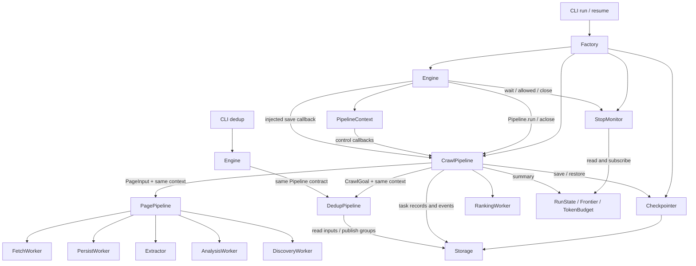
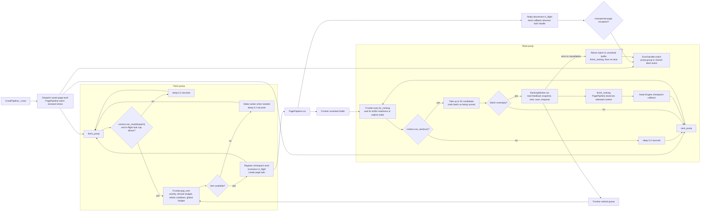
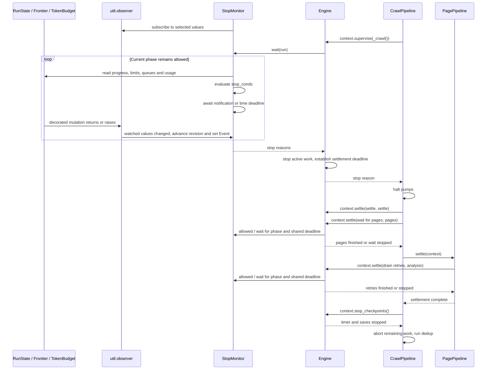
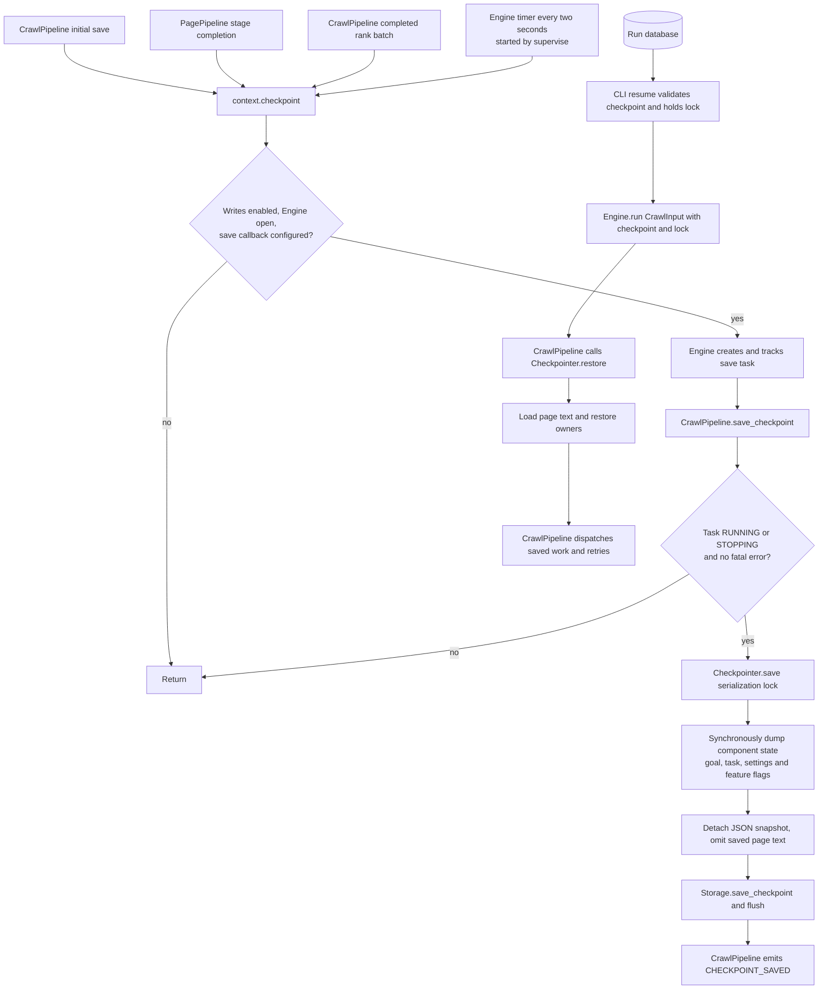
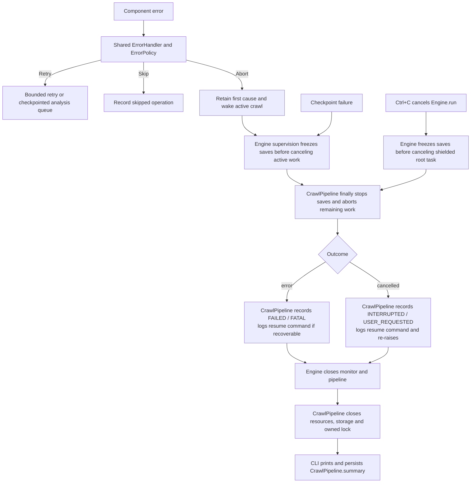

# Engine execution

Checked against the implementation on 2026-10-15.

Engine executes a Pipeline and owns stop supervision, settlement deadlines and
checkpoint timing. CrawlPipeline owns crawl preparation, stage composition, task
records and resource cleanup. All pipelines implement the same Protocol with
`run(input, context)` and `aclose()`.

## Ownership and composition

There is no separate root-pipeline interface. A pipeline can call another pipeline
with the same context. Workers perform stage operations; pipelines compose those
operations and own their task handles. DedupPipeline reads stored inputs, invokes
the grouper and publishes groups for both automatic and standalone dedup.

Engine depends on Pipeline and Monitor, not CrawlPipeline, CrawlGoal, CrawlTask,
Storage or Checkpointer. The factory injects `CrawlPipeline.save_checkpoint` as a
callback. CrawlPipeline owns its storage and child resources. DedupPipeline borrows
storage from its parent or CLI, so its close method does not close that storage.

PipelineContext supplies execution controls:

| Callback | Responsibility |
|---|---|
| `supervise(work)` | Run active work until completion, a stop decision or an error |
| `can_start(phase)` | Reject new work after supervision stops or the monitor disallows it |
| `can_finish(phase)` | Check whether the monitor permits finishing this phase |
| `settle(work, phase)` | Await a finishing step under live stop checks and one shared deadline |
| `checkpoint()` | Request an injected save while writes are enabled |
| `stop_checkpoints()` | Disable requests, cancel and await outstanding writes and timer |

The pipeline chooses which work needs supervision and where settlement belongs.
Engine implements those controls. Phase names are passed to Monitor without being
interpreted by Engine. A short standalone pipeline can simply return its result;
it need not create a supervision phase or configure a monitor.

PagePipeline owns AnalysisWorker preparation, retry startup, draining and closure.
CrawlPipeline coordinates those lifecycle boundaries through PagePipeline and does
not hold AnalysisWorker. Preparation binds the goal and task before checkpoint
restore; retry startup follows the initial committed checkpoint. Calling PagePipeline.run
directly also prepares analysis on its first page. Closing it cancels pending retries.

PagePipeline prunes its own page context after page work and analysis completion.
It subscribes to Frontier's context keys through the existing observer so ranking
completion and source retirement also release context. Pending dispatched work,
active pages, retries and unranked/scoring candidates retain their context. Closing
PagePipeline removes the subscription. CrawlPipeline registers dispatched work
before creating page tasks, preserving recovery if a task is canceled before it starts.

## Startup and crawl lifecycle

Before Engine.run, the CLI calls CrawlPipeline.startup to ingest supplied seeds,
enhance the goal and optionally expand seeds. These calls share the run's
ErrorHandler and token budget. A startup abort is retained until the initial
checkpoint has saved the supplied seeds. Resume skips enhancement and expansion.

```mermaid
flowchart TD
    Entry[Engine.run input] --> Guard[Reject an already started or closed Engine]
    Guard --> Root[Start and shield pipeline.run input, context]
    Root --> Crawl[CrawlPipeline receives CrawlInput]
    Crawl --> Lock[Acquire run lock unless supplied]
    Lock --> Prepare[Set task RUNNING, start storage, reset RunState<br/>prepare PagePipeline and task events]
    Prepare --> Bind[Bind Checkpointer to goal and task]
    Bind --> Restore{Checkpoint supplied?}
    Restore -->|yes| Load[Restore component state and saved page stages]
    Restore -->|no| Save
    Load --> Save[Save goal and task, await initial context.checkpoint]
    Save --> Active[context.supervise _crawl]
    Active --> Supervise[Engine starts periodic saves and waits for<br/>active work, monitor stop or checkpoint failure]
    Supervise --> Stop[Engine closes new-work admission<br/>starts shared 120-second settlement deadline]
    Stop --> Halt[CrawlPipeline records stop reason and STOPPING<br/>halts fetch and rank pumps]
    Halt --> Settle[context.settle pipeline settlement]
    Settle --> Pages[context.settle wait for dispatched pages]
    Pages --> Retries[context.settle drain analysis retries]
    Retries --> Freeze[finally: context.stop_checkpoints]
    Freeze --> Abort[CrawlPipeline.abort remaining tasks and retries]
    Abort --> Dedup[DedupPipeline.run goal, context]
    Dedup --> Finish[Prune page context, record final task and STOPPED event]
    Finish --> Close[Engine finally stops saves and closes monitor and pipeline]
    Close --> Resources[CrawlPipeline closes children and storage<br/>releases its owned lock]
```

CrawlInput contains the goal, task, optional checkpoint and optional caller-owned
lock. CrawlPipeline owns changes to `CrawlTask.state`. RunState holds runtime data
and has no duplicate task lifecycle state. Reset preserves seed preparation and
pre-run token usage; restore then loads checkpointed execution data.

## Concurrent crawl execution

CrawlPipeline prepares PagePipeline, dispatches saved `RunState.work` entries,
asks PagePipeline to start restored retries and launches two pumps. ErrorHandler watches the
pump group and its abort event. Page-task exceptions and fatal retry failures
reach the same event. Engine supervises the active crawl task, StopMonitor and the checkpoint timer.
CrawlPipeline records propagated failures without overwriting the last checkpoint.

The fetch pump reserves page budget using `pages_fetched + in_flight`. It also caps
dispatched page tasks at `fetch_concurrency + 2 * llm_concurrency`. These tasks may
be waiting for a stage semaphore, rather than making network requests.

PagePipeline limits the combined fetch, extraction and page persistence section
to `fetch_concurrency`. FetchWorker also limits its own requests. AnalysisWorker
limits initial and retried analysis calls to `llm_concurrency`. Its retry queue
is checkpointable and uses the same semaphore as first attempts. Ranking has
one pump, and LLMRanker splits a drained batch into sequential calls as needed.

## One page, including resumed stages

```mermaid
flowchart TD
    Input["PageInput(item, goal, task_id, events)"] --> Work["Retain page context<br/>find or create RunState.work[item_id]"]
    Work --> Saved{"Saved page in work entry?"}
    Saved -->|yes| Page["Load Page from restored work"]
    Saved -->|no| Fetch["FetchWorker.fetch<br/>robots checks, request slots and cooldown"]
    Fetch --> FetchOK{"FetchResult?"}
    FetchOK -->|no| Failed["Count robots refusal or fetch error<br/>record SKIPPED / FAILED outcome<br/>remove work entry, return"]
    FetchOK -->|yes| Raw["PersistWorker.save_raw"]
    Raw --> Extract["Extractor.extract in a thread<br/>bounded by extract_timeout"]
    Extract -->|timeout| Timeout["On timeout: count completed page<br/>record SKIPPED, remove work entry, return"]
    Extract -->|success| Store["PersistWorker.save_extracted<br/>save payloads and Page row"]
    Store --> Published["Tracker.published<br/>update source age streak and check retirement"]
    Published --> Mark["Save page, HTTP status and raw size in work"]
    Mark --> CP1["Await checkpoint"] --> Page
    Page --> Open["Open PageBook association<br/>page URL to source seed"]
    Open --> Analyzed{"analysis_done?"}
    Analyzed -->|no| Analyze["AnalysisWorker.analyze<br/>wait for slot, then recheck context.can_finish(analysis)"]
    Analyze --> MarkAnalysis["Mark initial attempt done<br/>await checkpoint"] --> Discover
    Analyzed -->|yes| Discover["DiscoveryWorker.discover<br/>harvest saved HTML and payloads in a thread"]
    Discover --> Tracked{"discovered flag set?"}
    Tracked -->|no| Track["Tracker.discovered<br/>join listing status with verdict<br/>check source retirement, mark discovered"]
    Tracked -->|yes| Seed["Restore seed attribution on harvested candidates"]
    Track --> Filter
    Seed --> Filter["PreFilter each candidate<br/>scope, depth, dedup, robots and date rules"]
    Filter --> Buffer["Allowed candidates to unranked buffer<br/>queue link records in storage"]
    Buffer --> Next{"next_url present and next_page flag absent?"}
    Next -->|yes| Pagination["Filter continuation, enforce source pagination cap<br/>enqueue at same depth, priority 0.5<br/>mark next_page handled"] --> Complete
    Next -->|no| Complete["record_outcome COMPLETED<br/>increment pages_fetched<br/>remove work, release/prune context<br/>await checkpoint"]

    Analyze -. successful initial result .-> Apply["AnalysisWorker.apply<br/>stable result IDs, save_analysis, Tracker.analysis<br/>Tracker marks work analysis_done"]
    Analyze -. recoverable failure .-> Retry["AnalysisWorker retry queue<br/>page flow continues"]
    Retry -. successful later result .-> Apply
    Apply --> Feedback["Mark matching work.analysis_done<br/>notify PagePipeline to retire source and prune"]
```

`analysis_done` means the initial stage was handled, not that a valid result exists.
An attempt can be skipped by policy, return no result or schedule a retry. Discovery
still follows it. Retry results use the same result sink as initial successes.

Recovery can skip fetching and the initial analysis. Discovery is rerun even when
its tracking flag is set, because candidate admission may have been interrupted.
The flag prevents repeated discovery statistics. Frontier deduplication handles
repeated candidate admission. Each page task releases retained context in `finally`.
Unexpected stage exceptions record a failed frontier outcome and propagate to
CrawlPipeline, which records the failed task. A missing adapter dependency follows this fatal path.

Source retirement is separate from stopping the whole run. `why_retire()` in
`runtime/tracking.py` checks the source's relevance window and age streak.
PagePipeline records the reason and retires that source's queued work through
Frontier. In-flight pages continue. `recall` disables source retirement. Listing
continuations bypass ranking and allow up to five additional pages per seed.

## Stop supervision and settlement

Monitor owns its revision and Event. Notifications are synchronous comparisons of
selected values before and after decorated mutations, including exceptions and
cancellation. Monitored classes only use `@notify`; they do not bind listeners.
Subscriptions are per instance and use weak references. Engine closes them with
Monitor. Ordinary changes wake Monitor, while Engine wakes for a stop decision,
work completion, deadline or checkpoint failure. There is no polling stop loop.

| Condition | Trigger | Dispatched pages may settle | Retries may drain |
|---|---|---|---|
| `BUDGET_PAGES` | Completed-page counter reaches the positive limit | Yes | Yes |
| `FRONTIER_DRAINED` | Ranked, unranked, ranking and in-flight counts are all zero | Yes | Yes |
| `DOMAIN_BUDGET` | Frontier drained after refusing candidates at the domain ceiling | Yes | Yes |
| `ADAPTER_EMPTY` | Frontier drained after at least three listings, all empty | Yes | Yes |
| `MAX_RELEVANT` | Relevant-page counter reaches the positive target | Yes | No |
| `BUDGET_TOKENS` | Shared recorded usage reaches the positive limit | No | No |
| `BUDGET_TIME` | Active elapsed time reaches the positive limit | No | No |
| `LOGIN_REQUIRED` / `RATE_LIMITED` | A recorded run-wide platform refusal | No | No |
| `FATAL` | A recorded run failure | No | No |

All applicable reasons must permit a phase. Page settlement and retry draining
share one 120-second deadline, including time spent in earlier settlement steps.
A later token/time limit can end settlement after a result-target stop. Ending the
page wait leaves page tasks alive until checkpoint writes are frozen; CrawlPipeline
then cancels remaining work. The recorded stop reason remains the one returned
when active supervision ended.

Dedup runs after normal settlement, outside that deadline. The shared token budget
can prevent its model call. Invalid output retains existing results; an account
failure fails the run. Cancellation bypasses dedup.

## Checkpoints and recovery

Page and rank tasks await the same checkpoint callback as the timer. Engine tracks
all requests, including saves waiting for Checkpointer's serialization lock. Before
canceling work, Engine disables new requests, cancels the timer and saves, and
awaits them. Checkpointer owns snapshot format and serialization; CrawlPipeline
owns task-state eligibility and restore. Engine owns write timing and shutdown.

Snapshots contain unfinished page stages, ranked and unranked queues, unfinished
ranking batches, analysis retries, source history and recorded token usage. Page
text is restored from stored page rows. Earlier queued results precede their
checkpoint. Recovery uses only committed snapshots and excludes stopped time from
elapsed execution time.

Work newer than the last snapshot may repeat. Stable analysis and item IDs replace
repeated outputs, but provider calls and billing are not exactly-once. Recovery
does not require a final checkpoint on exit. Credentials come from the current
environment. Resume accepts RUNNING, INTERRUPTED and FAILED tasks and releases its
caller-owned lock after Engine returns.

## Cancellation, errors and reports

Components have no Engine callbacks. ErrorHandler is shared across startup, workers
and dedup. Engine propagates execution errors; CrawlPipeline translates them into
crawl task records and resume guidance. Cleanup failures also mark the crawl as
failed. The generic Engine neither formats crawl reports nor records crawl errors.

Each LLM request has a 90-second total timeout and a waiting notice after 30 seconds.
ErrorPolicy owns retry, skip and abort decisions. Provider messages retain model,
stage, HTTP status and provider code when available. Account failures abort at once;
shared-service temporary failures abort after bounded retries. Invalid output can
be skipped. Dedup retries cover grouping, not database writes.

Ctrl+C cancels asynchronous work without waiting for model responses or starting
final grouping. Local cleanup still writes the task record and closes resources.
Cancellation does not stop parser threads already running. A hard kill can leave
a RUNNING task but releases its OS lock. A second Ctrl+C exits with code 130.

CrawlPipeline.summary combines runtime statistics, shared token usage and the dedup
report. CLI run and resume pass that dictionary to the same report writer after
cleanup. Reporting and exit codes remain outside Engine.
